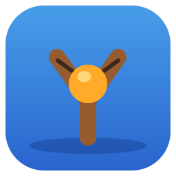

<p align="center"></p>

<h1 align="center">slingshot-animals-recomp</h1>

<p align="center"><a href="https://recomplauncher.com/game/slingshot-animals-recomp"><picture><source media="(prefers-color-scheme: dark)" srcset="https://recomplauncher.com/assets/press/launcher/badge-light.svg"></picture></a></p>

Unofficial static recompilation of Rovio's old Android *Angry Birds* games. Each game's native ARM library is translated to C++ and runs natively on Linux, Windows, macOS, 64-bit Android and the Nintendo Switch (homebrew), without an emulator.

> [!IMPORTANT]
> **No game files are included or linked here.** You need your own legally obtained copy of each game.
>
> The game is built locally on your device, for your personal use only.

## Install

1. Download **Slingshot Builder** for your system from the [releases](https://github.com/Berny23/slingshot-animals-recomp/releases/latest) (Linux AppImage, Windows exe, macOS app).

2. Open the builder:
    - **Linux**: Just run the AppImage. It can be updated with tools like [Gear Lever](https://flathub.org/apps/it.mijorus.gearlever) or AppImageUpdate.
    - **Windows**: As the builder is not signed, SmartScreen may warn you, which is normal. Just click *More info* → *Run anyway*.
    - **MacOS**: Open the builder with right-click → *Open* the first time. It needs Apple's Command Line Tools and offers to install them.

3. Drop the APK of a [supported version](#supported-versions) onto the window, then build for your favorite platform:
    - **Linux/Windows/macOS**: Press *Build & Install*. Each game then appears in your system as a separate app.
    - **Android**: Select *Build Android APK only...*, choose a location and wait for building to finish. Then copy the generated APK file onto your phone and install it. Advanced users can alternatively install via ADB directly on a connected phone.
    - **Nintendo Switch (homebrew)**: Select *Build for Nintendo Switch (homebrew)...* wait for building to finish. Then copy the `.nro` file into `switch/` on your SD card and start the game from the Homebrew Menu.

To uninstall the games on Linux, just delete them under `~/.local/lib/slingshot-animals-recomp/` and their menu entries at `~/.local/share/applications/slingshot-<id>.desktop`.

## Features

- Runs the original game logic, graphics, sound and text rendering natively
- Plays offline: Rovio's online services, ads and in-app purchases are stubbed
- Mouse or touch screen as on Android, Esc is the Back key
- Language follows the system locale or `--locale`
- Mods for keyboard and gamepad play, offline versions of online features and more, see below

## Mods

All mods but those marked *(off)* are on by default. In the builder, *Advanced* chooses which ones a game starts with; `--disable-mod <name>` and `--enable-mod <name>` turn one off or on for a single start.

| Mod | Games | Description |
| --- | --- | --- |
| `mouse-wheel` | all | Mouse wheel zooms in levels and scrolls menus |
| `keyboard` | all | Play with the keyboard: hold Space, aim with W A S D or arrows, release to shoot, Space again for the bird's ability (hold it and W A S D or arrows steer aiming abilities); arrows move the camera, + / - zoom, R restarts, P pauses, Enter continues |
| `gamepad-pointer` | all | Play with a gamepad: the left stick moves a cursor (right stick slowly), A taps, triggers zoom, B is Back |
| `tap-to-skip` | all | Tap to skip the wait at the end of a level |
| `fullscreen` | all | F11 toggles fullscreen. `--mod-option fullscreen.start=1` starts in fullscreen (also RecompLauncher's Big Picture mode, unless `=0`), `--mod-option fullscreen.aspect=16:9` keeps the game at 16:9 in fullscreen, with black bars on ultrawide screens |
| `phone-scale` | Star Wars | On phones, menus and buttons are as large as in the other games |
| `hide-dead-services` | all | Hides buttons and messages of discontinued online services |
| `offline-shop` | all | Everything sold for real money can be earned by playing |
| `game-statistics` | all | Statistics page with achievements and progress to 100 %; the achievements also count in RecompLauncher (Recomp Achievements) |
| `offline-league` | Classic | Mighty League without servers |
| `offline-tournament` | Seasons | Pig Challenge without servers: weeks open one after another, all weeks replayable after the last |
| `composite-audio` | Star Wars, Star Wars II | Plays the menu music and power-up sounds again |
| `offline-assets` | Star Wars II | Starts without the download server (see below) |
| `audio-quality` | Stella | Stereo sound at 24 kHz, better than on Android |
| `seasonal-menu` | Seasons | Before an episode is played, the main menu shows a random episode of the current season instead of Ragnahog. The splash screen shows the logo of the menu's episode instead of the hardcoded Ragnahog picture. `--mod-option seasonal-menu.season=<name>` picks one |
| `offline-clock` | Star Wars II | Timed features use the device's clock |
| `missing-translations` | Rio | Translates texts the game shows only in English |
| `samsung-level` | Space, Star Wars II | Content once given only to Samsung devices is open everywhere |
| `unlimited-money` *(off)* | Classic, Seasons, Rio, Star Wars II, Stella | Coins, gems and credits do not run out. Warning: Cheated saves never get RecompLauncher achievements |
| `unlock-episodes` *(off)* | Classic, Seasons, Rio, Star Wars, Star Wars II | Every episode can be played from its first level, without stars, coins or the episodes before it. The levels in it open as usual. Classic and Seasons save the episodes as unlocked |

## Supported versions

APKs with the `armeabi-v7a` library:

| Id | Game | Version | Package |
| --- | --- | --- | --- |
| `classic` | Angry Birds Classic | 8.0.3 (build 8031) | `com.rovio.angrybirds` |
| `seasons` | Angry Birds Seasons | 6.6.2 (build 6620) | `com.rovio.angrybirdsseasons` |
| `rio` | Angry Birds Rio | 2.6.13 (build 2676) | `com.rovio.angrybirdsrio` |
| `space` | Angry Birds Space HD | 2.2.14 (build 221400) | `com.rovio.angrybirdsspaceHD` |
| `starwars` | Angry Birds Star Wars HD | 1.5.13 (build 151300) | `com.rovio.angrybirdsstarwarshd.premium.iap` |
| `starwars2` | Angry Birds Star Wars II | 1.9.25 (build 192500) | `com.rovio.angrybirdsstarwarsii.ads` |
| `stella` | Angry Birds Stella | 1.1.5 (build 1152) | `com.rovio.angrybirdsstella` |

The build checks each library's SHA-256.

Star Wars II downloads its sounds and theme images from a server that is gone; without them it has no music and draws placeholder backgrounds. For the originals, take `files/assets_service/` from a device installation (`/data/data/com.rovio.angrybirdsstarwarsii.ads/`). The builder asks for it as a ZIP file or folder when building the game (`-DGAME_EXTRA_starwars2=<zip or folder>` in a CMake build). Alternatively, copy the folder into the game's [save folder](#run), on Linux:

```
~/.local/share/slingshot-animals-recomp/starwars2/internal/files/assets_service/
├── 16000hz-16bit-mono/    music/ and sfx/ (*.mp3)
└── images/                android/ (THEME_*.pvr, THEME_*.dat)
```

## Build

Needs CMake 3.28, Ninja or Make and a C++20 compiler. On Linux also capstone, SDL3, FreeType, HarfBuzz, liblzma and zlib; elsewhere these are downloaded and built (`-DSLINGSHOT_SYSTEM_DEPS=OFF` does the same on Linux).

```
cmake -S . -B build -DGAME_APKS="/path/to/angrybirds.apk;/path/to/angrybirdsrio.apk"
cmake --build build
```

Each APK is matched to its game by the library and extracted to `build/games/<id>/`; every game gets its own executable `build/bin/slingshot-<id>`. Recompiling a game needs up to 1.5 GB of memory, so games are recompiled one at a time. Build options:

- `-DSLINGSHOT_DEFAULT_MODS=default|all|none|<list>`: mods enabled by default, e.g. `"hide-dead-services;offline-shop"`; `default` is all but those marked *(off)*
- `-DSLINGSHOT_MODS=OFF`: build without mods

Cross builds use the recompiler built for this machine (`-DSLINGSHOT_HOST_TOOLS=build/host-tools`):

- Windows: `-DCMAKE_TOOLCHAIN_FILE=cmake/toolchains/llvm-mingw.cmake -DLLVM_MINGW=<llvm-mingw>`
- Nintendo Switch: `-DCMAKE_TOOLCHAIN_FILE=cmake/toolchains/switch.cmake -DDEVKITPRO=<devkitpro>` builds `bin/slingshot-<id>.nro`; needs devkitPro's `devkitA64`, `libnx`, `switch-tools` and `switch-sdl2`
- Android: `-DCMAKE_TOOLCHAIN_FILE=<ndk>/build/cmake/android.toolchain.cmake -DANDROID_ABI=arm64-v8a -DANDROID_PLATFORM=android-24 -DSLINGSHOT_ANDROID_SDK=<sdk> -DSLINGSHOT_JDK=<jdk>` builds `bin/slingshot-<id>.apk`, signed with `-DSLINGSHOT_ANDROID_KEYSTORE` (created if missing; updates need the same key)

The builder app is a separate project: `cmake -S tools/builder -B build-builder && cmake --build build-builder` builds `build-builder/slingshot-builder` (Qt 6.5 or newer). It builds in KDE's Breeze style and uses it everywhere; `-DSLINGSHOT_BUILDER_BREEZE=OFF` keeps Qt's platform styles.

## Run

```
build/bin/slingshot-<id> [options] [game-dir]
```

| Option | Description |
| --- | --- |
| `--help` | Show the options |
| `--list-mods` | List the mods |
| `--mod <name>` | Enable only the given mods (repeatable), like `SLINGSHOT_MODS=a,b` |
| `--enable-mod <name>` | Enable a mod in addition to the others |
| `--disable-mod <name>` | Disable a mod |
| `--no-mods` | Original game without mods |
| `--mod-option <mod>.<key>=<value>` | A setting for a mod (repeatable), see the mod table |
| `--locale <ll_CC>` | Game language, e.g. `de_DE` |
| `--data <dir>` | Keep the saves in `<dir>` instead of the folder below |
| `--dump-scripts <dir>` | Write the game's scripts and configs out decrypted |

Saves are in `~/.local/share/slingshot-animals-recomp/<id>/` (or `$XDG_DATA_HOME`) on Linux, `%APPDATA%\slingshot-animals-recomp\<id>\` on Windows, `~/Library/Application Support/slingshot-animals-recomp/<id>/` on macOS and `sdmc:/switch/slingshot-animals-recomp/<id>/` on the Switch; on Android they stay in the app's storage until it is uninstalled. They are encrypted by the game; copy the folder while the game is not running to back them up.

## Modding

The game logic is Lua 5.1 bytecode (4-byte numbers), the configs are JSON. In the APK both are encrypted and compressed; the games read plain scripts too:

1. `build/bin/slingshot-<id> --dump-scripts ~/ab-scripts` writes the scripts (`data/**/*.lua`) and JSON files in the layout of `assets/`, decrypted by the game's own code. Classic also writes `config.json` and `data/config/*.zip`. A script that is a 7z archive is written as `<name>.7z` where the game's loader for it is not hooked.
2. Replace a script in `build/games/<id>/assets/` with an edited one, as Lua source or bytecode. Classic and Seasons take plain JSON files and configs too.

Sprite sheet descriptions (`*.sheet.json`, `*.compo.json`) are dumped for reference but cannot be replaced yet. The built-in mods patch scripts in memory, see [docs/ARCHITECTURE.md](docs/ARCHITECTURE.md).

## Note

This project does not include any original game files. You need your own copies of the APKs. It is not affiliated with or endorsed by Rovio; *Angry Birds* is a trademark of Rovio Entertainment.

## License

[GPL-3.0-or-later](LICENSE)
